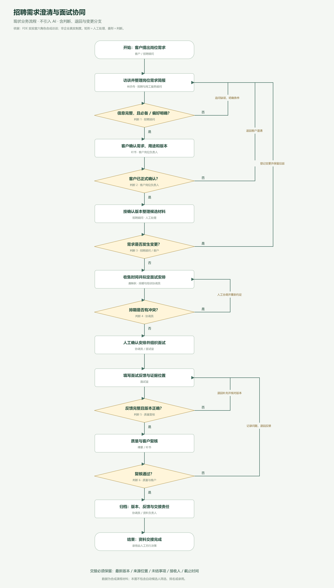

# 需求有据：招聘需求澄清与面试协同

**2026-11-19新增 SaaS MVP**：[五项交付说明](docs/MVP交付说明.md)。新模块位于 `mvp/`，包括 FastAPI、Agent Harness、RAG与LLM适配器、Wiki及关系图谱、后端租户/角色/层级权限。实际部署状态见 [部署记录](docs/mvp-deployment.json)。旧版无AI流程与规则原型保留作为现状基线；新MVP默认未配置LLM时明确采用原文摘录。

FDE 九阶段实验项目，面向 `fsg-recruiting` 合成训练场景。完成六角色在线访谈、九阶段共27项任务的分析与交付文档，并实现**不接入 AI 的确定性规则原型**。

该场景参考上海外服公开业务方向；角色、事件、样本和基线是实验室合成材料，不代表上海外服真实业务、员工访谈或认可。本项目与该企业没有正式合作或授权关系。

课堂要求已逐项核对并补齐文件：[交付清单](docs/交付要求核对.md)。原创实现采用 [MIT协议](LICENSE)，外部材料保留 [来源说明](THIRD_PARTY_NOTICES.md)。

## 已交付

- 六角色实际在线提问：36轮基础访谈、36/36事实，以及[9次UAT、评审、交接和事件问答](docs/virtual-reviews.md)。原始回答、时间和调用审计保留在 [证据目录](docs/evidence)。实验室角色由平台模型驱动，与本项目不接模型的业务原型分开说明。
- 九阶段报告、27项任务结论、证据位置及责任角色，见 [任务索引](docs/index.md)。尚未执行的真实用户验收、收益核验、上线与签收保持待完成。
- [不引入AI的现状流程图](docs/flowcharts.md)：包含6个判断点和返工路径，提供Mermaid、可编辑SVG及PNG。
- 本机可运行工作台：字段缺项、条件分类、反馈版本、排期冲突、权限、人工确认、事务幂等与审计。
- 18项单元测试×3轮、HTTP闭环、12并发同键幂等验证及本地数据库恢复，详见 [执行证据](docs/evidence/verification.json)。

## 快速运行

需要 Python 3.10+；业务原型只使用标准库，无需模型API或第三方依赖。

```powershell
python -m src.server
```

打开 [本机演练工作台](http://127.0.0.1:8000)。可先运行“异常样本”，查看待澄清条件、旧版反馈及排期冲突，再切换正常样本，生成核对单，切换质量角色执行人工确认。数据库存放在忽略的 `runtime/` 目录。

```powershell
python scripts/verify.py
node --check src/web/app.js
```

测试无需访问实验室或GitHub，不调用真实模型和业务系统。Node仅用于可选的前端语法检查。[CI配置模板](docs/ci-workflow.yml)可在Windows与Linux运行同一脚本；现有GitHub登录缺少workflow权限，因此没有启用云端Actions，本次通过的是本地验证。

## 目录

```text
README.md
docs/                九阶段报告、需求、架构、ROI、UAT、运行手册、流程图
  evidence/          实际采集的合成访谈、平台报告、验证日志及来源信息
  diagrams/          无AI流程图 SVG / PNG
src/                 规则引擎、SQLite事务、HTTP服务及网页界面
tests/               正常、边界、对抗、权限、故障验证
examples/            自建合成输入；不是企业原始资料
scripts/             验证、访谈采集、文档生成与图形生成工具
```

## 业务流程

新版按“需求澄清 → 面试协同 → 反馈闭环”分区，保留6个判断与返工分支。[可编辑SVG](docs/diagrams/as-is-no-ai.svg) / [离线缩放预览HTML](docs/diagrams/as-is-no-ai.html)（下载仓库后双击打开）。



## 证据和限制

实验室按Cookie隔离，原链接的练习无法跨会话读取，本项目使用同一 `fsg-recruiting` 场景的新练习，具体URL和练习ID见 [来源记录](docs/evidence/provenance.json)。平台可能在重新打开训练页时重置任务状态，因此仓库保留独立任务记录与同步结果。

工程测试通过不等于真实业务验收。四项任务仍需实际证据：用户独立UAT、试点价值归因、上线三方批准、正式交接签收。ROI使用明确标注的情景假设，不宣称已实现节省。正式上线结论为NO-GO。

本机界面允许切换演练角色，不是企业身份认证；未实现生产SSO、跨租户隔离、完整读取审计或真实只读接口。请仅使用合成输入，勿导入真实简历、联系方式或其他个人信息。工具不提供自动候选人评分、筛除、排名、录用、对外通知或生产写回。

## 资料依据

- 用户提供的《FDE九阶段流程课件》：按九阶段27任务组织，课件未整份公开转发。
- [上海外服公司概况](https://www.fsg.com.cn/AboutUs_Profile.html)及[数字化介绍](https://www.fsg.com.cn/AboutUs_Profile_Digitization.html)：仅用于公开行业背景。
- [公开资料与四来源核对](docs/public-research.md)、[原始访谈与台账](docs/interviews-and-evidence.md)。

采集脚本需要额外安装 `requests`，并使用本机TEMP目录中的演练Cookie与活动练习配置；Cookie、令牌和运行数据库均不纳入仓库。原型运行和测试不依赖采集脚本。
