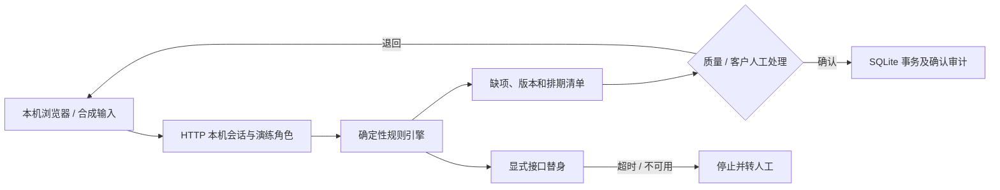

# 架构、契约与系统边界

## 数据契约 v1

输入样本见 [normal.json](../examples/normal.json)。顶层只允许brief、feedback、schedule、adapter_mode、model_mode。

- brief：job_id（岗位代号）、version（正整数）、owner、location、headcount（正整数）、source_id、conditions。
- conditions：id唯一、kind为must/preferred/clarify、text为原文、source为来源位置。clarify不是缺失，二者均不能默认通过。
- feedback：brief_version、condition_id、evidence_ref，不接受候选人打分或录用字段。
- schedule：interviewer_id为虚构代号；start/end为带时区ISO8601，end必须晚于start。
- adapter_mode：stub正常；timeout/unavailable故障注入。model_mode仅disabled/stub，不调用模型。

## 接口

- GET /api/health：版本与演练模式。
- GET /api/session：本地演练令牌。该令牌是本机会话防误操作措施，不能替代企业身份体系。
- POST /api/check：创建核对单。请求头Authorization: Bearer本机令牌、X-Demo-Role、Idempotency-Key。返回id、revision、state、input和result。
- POST /api/review：输入id、revision、decision（confirmed/returned）、note。阻断项不可confirmed。
- GET /api/reviews、/api/audit：需要本地令牌。
- 错误：400契约错误、401会话无效、403角色不允许、404记录缺失、409幂等碰撞或版本冲突。

## 责任与权限

consultant/coordinator/quality可创建；quality/client可确认或退回；engineer只能查看演练记录。UI支持切换角色以测试权限，**不是身份认证**。不同客户的真实租户隔离尚未实现。不能导入真实个人信息，嵌套字段也不提供自动脱敏保证。

## 与真实系统的差距

访谈仅允许脱敏只读导出（fsg-recruiting-f32），本原型完全使用自己构建的合成样本。没有真实接口凭证、生产系统、模型服务或消息通道。f34要求的业务发生时间/系统接收时间双时间与完整版本有效期是下一轮需求；当前只检查显式版本引用和排期时间。正式接入必须增加授权用途、SSO、逐租户权限、来源文件校验、读取审计、留存策略及原始版本链。
