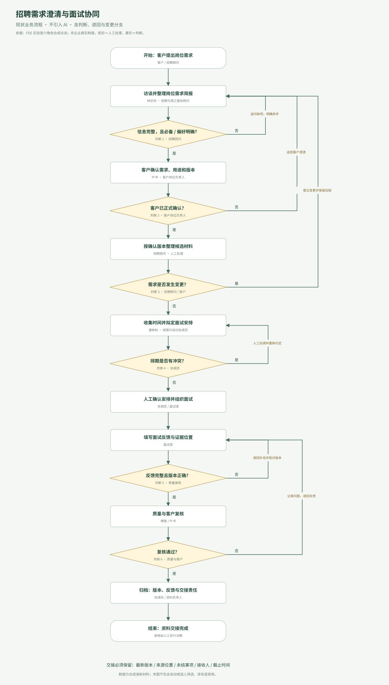
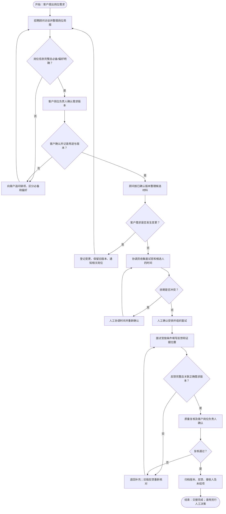
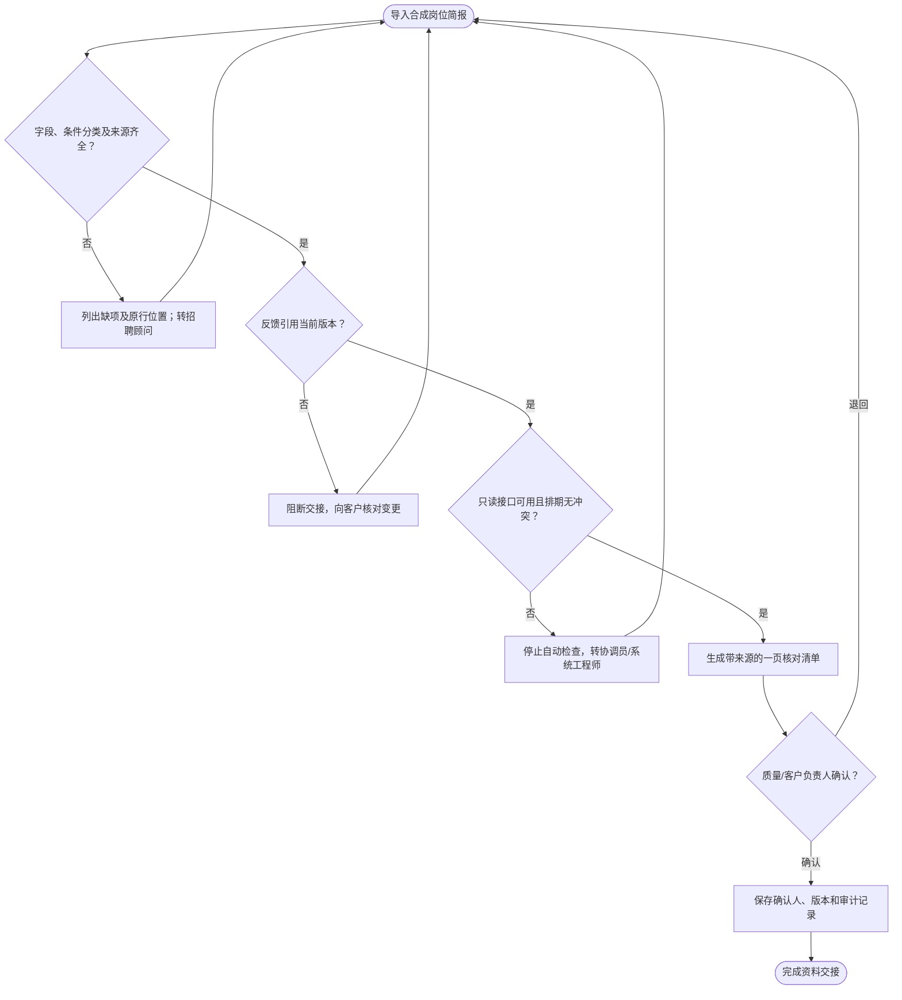

# 招聘需求澄清与面试协同：不引入 AI 的流程

依据：六角色合成访谈，原始记录见 [interviews.json](evidence/interviews.json)。流程为对访谈的分析还原，非上海外服真实制度。菱形均为人工判断或确定性规则检查。

## 现状流程（带判断及返工）

## 规则辅助方案（同样不引入 AI）

上述流程不自动评价、排名、筛除或录用候选人。生产通知与面试邀请也不由原型发送。当前原型可检查显式字段、版本引用与排期重叠；无法从任意自然语言中可靠推断“必备/偏好”，分类仍由人完成。
